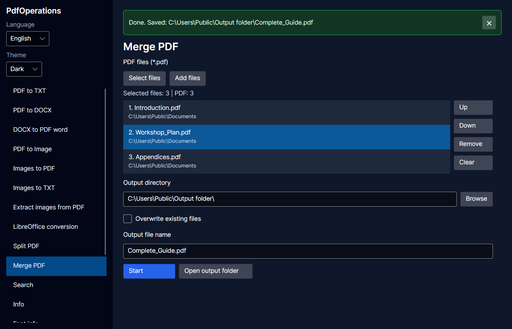
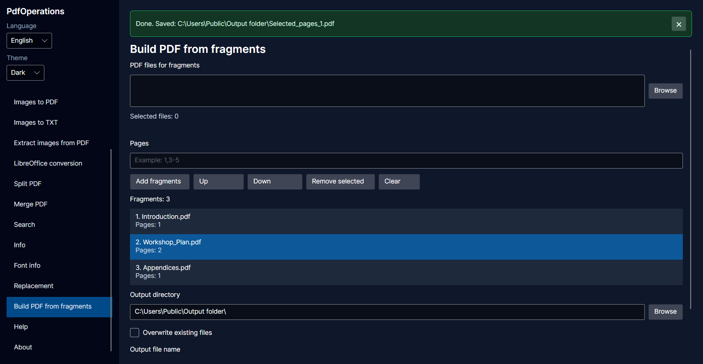
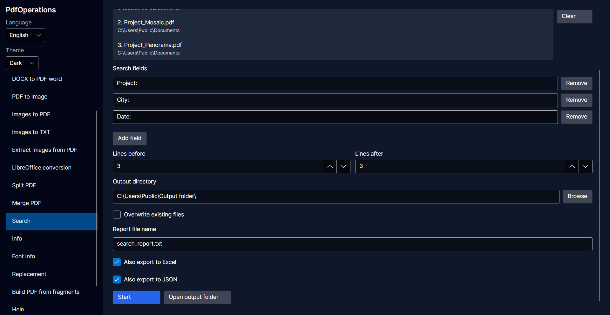

# PdfOperations

**English** | [Polski](README.pl.md)

PdfOperations is a Windows desktop application for working with PDF files, images, text and office documents. It provides an Avalonia GUI in Polish and English, with light, dark and system themes.

The repository also contains the original console application. This guide describes the GUI workflow.

## Features

| Operation | Description |
| --- | --- |
| PDF to TXT | Extract selectable text from PDF files. |
| PDF to DOCX | Convert PDF files into Word documents using the pdf2docx tool. |
| DOCX to PDF (Word) | Convert Word documents using installed Microsoft Word. |
| PDF to images | Render PDF pages as images. |
| Images to PDF | Combine images into a PDF in the selected order. |
| Images to TXT | Recognize text in images with Tesseract OCR. |
| Extract images | Extract embedded images from PDF files. |
| LibreOffice conversion | Convert office documents to PDF, DOCX, ODT, XLSX, HTML or TXT, where supported by LibreOffice. |
| PDF pages | Extract selected, even or odd pages; split after selected pages or into individual pages. |
| Merge PDF | Combine PDFs in the order shown in the file list. |
| PDF from fragments | Combine selected page ranges from multiple PDFs and arrange their order. |
| Search | Search multiple phrases in PDF, TXT and image files; save a TXT report and optionally export extracted values to Excel and JSON. |
| PDF information | Read PDF metadata, page counts and font information. |
| Text replacement | Replace text in DOCX, ODT and ODG documents using an Excel replacement table. |

The GUI includes file counts, file-type filters, progress indicators, cancellation, overwrite control and expandable error details. Language and theme preferences are saved between sessions.

## Requirements and startup

- **To run the slim package on Windows x64:** install the [.NET 10 Desktop Runtime](https://dotnet.microsoft.com/en-us/download/dotnet/10.0). Under **.NET Desktop Runtime**, choose the **Windows x64** installer. The SDK is not required.
- **For PDF → DOCX:** install [Microsoft Visual C++ v14 Redistributable x64](https://aka.ms/vc14/vc_redist.x64.exe), version 14.50.35719 or later.
- **For DOCX to PDF (Word):** an installed and activated copy of Microsoft Word is needed. Without Word, choose **LibreOffice conversion**; LibreOffice is included in the package.
- External tools and their supporting files must be present in the expected `tools` directory next to the application.
- The application needs write access to the output and temporary directories, with sufficient free disk space.

For a packaged build, extract the whole archive to a folder and run `PdfOperations.Gui.exe`. Do not run it directly from the archive or move only the executable away from its supporting files.

Choose an operation from the left sidebar to begin. The built-in **Help** view is available in both interface languages.

## General usage

1. Choose an operation from the sidebar.
2. Use **Select files** to choose input files. This replaces the current list.
3. Use **Add files** to append more files, including files from other folders.
4. Set the output folder and any required options, such as a file name, page range or search fields.
5. Click **Start**, then use **Open output folder** to inspect the results.

**Remove** removes selected entries from the list, while **Clear** empties the list. Neither deletes the source files from disk. Multiple entries can be selected for removal.

Where order matters, use **Up** and **Down** before starting. PDF merging uses the displayed list order, not a new alphabetical sort at conversion time.

An empty output-folder field is filled from the first input file where supported. An already selected output folder is not replaced automatically. Check this folder before starting, especially when inputs come from several locations.

When **Overwrite existing files** is off, conflicting output names receive numeric suffixes. Enabling it allows existing destination files to be replaced. Separate inputs with the same base name still need distinct output names within one batch. Keep backups when overwriting.

**Cancel** requests that the operation stop. Cancellation is not an undo action: files already saved may remain in the output folder. Temporary-file cleanup is attempted after completion, failure and cancellation; locked files can still prevent cleanup.

## PDF pages and fragments

Page numbers start at 1. Custom selections support individual pages and ranges, for example `1`, `2-5` or `1,3-5,8`.

- **Selected pages** creates a PDF containing the requested pages.
- **Even pages** and **Odd pages** select pages automatically.
- **Split after pages** treats each entered number as the last page of the preceding part. For example, splitting a seven-page PDF after pages `2,5` produces parts containing pages 1-2, 3-5 and 6-7.
- **Split every page** creates a separate PDF for each page.

Use **PDF from fragments** to assemble page ranges from several source PDFs. Add the ranges, check the page counts, and reorder the fragment list before starting.

## Search and extraction

Search accepts PDF, TXT and image files. Use the file-type filter in the selection dialog to avoid accidentally mixing PDFs with previously generated TXT reports.

Enter one phrase under **Search fields**, then use **Add field** for additional phrases. Empty fields are ignored. At least one phrase is required, and field names must be unique regardless of letter case.

The TXT report contains case-insensitive matches for all phrases, including matches within longer text. The lines-before and lines-after settings control the surrounding context included in the report. `[0]` marks the matching line, `[-1]` the preceding line, and `[+1]` the following line.

### Excel and JSON exports

Select **Also export to Excel**, **Also export to JSON**, or both. The TXT report is saved as well.

To extract values, use labels found in the documents. Labels are arbitrary user-entered phrases, not a built-in list of phone numbers, tax identifiers or addresses. For example:

```text
Reference: 00123
Company:
Example Studio
```

Searching for `Reference` and `Company` can extract `00123` and `Example Studio`. For each phrase, choose whether to save the entire matching line or just the value after the phrase. Search is case-insensitive and can also match a phrase within longer text.

**With "Export each match as a separate record" unchecked (summary):**

- Each input file produces one Excel row or JSON object. Full paths distinguish files with the same name in different folders.
- Each search field produces an Excel column or an entry under the JSON fields object.
- Identical values within one file and field are stored once. Different values are separate lines in one Excel cell or items in a JSON array.
- Missing values produce an empty Excel cell or an empty JSON array.

**With "Export each match as a separate record" checked:**

- Each matching line for each phrase produces a separate Excel row or JSON object containing the file name, full path, page, line, phrase and value.
- Repeated values are preserved. A match with no extracted value is included with an empty value; files with no matches produce no records.
- Several occurrences of the same phrase on one line produce one record for that line, not one record per occurrence.

For example, two different phone numbers found in one PDF occupy two lines in one Excel cell (or two items in a JSON array) in summary mode. With separate records enabled, they occupy two rows or objects, provided they were found on different lines. The summary keeps all distinct values, not just the last result.

**In both modes:**

- Values are stored as text, preserving leading zeros.
- The interface language at the start of the operation determines the fixed Excel headers, worksheet name and JSON keys. Search phrases and extracted values are not translated.
- The export mode does not change the TXT report. Neither mode automatically pairs names, phone numbers or other fields belonging to the same person.

| Export label | English | Polish |
| --- | --- | --- |
| Excel worksheet | `Results` | `Wyniki` |
| Excel file name | `File name` | `Nazwa pliku` |
| Excel file path | `File path` | `Ścieżka pliku` |
| JSON file name | `FileName` | `NazwaPliku` |
| JSON file path | `FilePath` | `SciezkaPliku` |
| JSON fields | `Fields` | `Pola` |
| Page in separate records | `Page` | `Strona` |
| Line in separate records | `Line` | `Linia` |
| Phrase in separate records | `Phrase` | `Fraza` |
| Excel value in separate records | `Value` | `Wartość` |
| JSON value in separate records | `DesiredValue` | `Wartosc` |

If another program consumes the exported JSON, account for these language-dependent keys.

### Extraction limitations

In value-only mode, text is read after the phrase and an optional colon. If that text is empty, the next nonempty line on the same page is checked. This does not depend on the lines-before or lines-after settings of the TXT report. Whole-line mode saves the matching line instead.

If the next line is another search label, the value remains empty. An unknown label can instead be mistaken for a value. For example, when searching only for `Reference`, an empty `Reference:` followed by `Address: Main Street` may yield `Address: Main Street`. Review exported data before using it.

Value-only mode tries to stop before the next label, including an unselected label after a comma when it is followed by a colon. This is a heuristic, not a document schema: ambiguous text may still need manual correction. Whole-line mode preserves the matching line without this trimming.

PDF search reads the PDF text layer; it does not automatically OCR scanned PDF pages. For scans without selectable text, render the pages as images first and use OCR or image search. OCR accuracy depends on image quality and available language data.

## Text replacement

In **Replacement**, click **Download Excel template** below the Excel file picker. Choose a folder to save `replacement-template.xlsx`. The app generates this file locally, so no internet connection is needed. Saving the template does not start replacement or select it automatically.

Open the file in Excel or LibreOffice Calc, replace the sample rows with your own substitutions, and add more rows as needed. Save it as `.xlsx`, then select it using **Browse** next to **Excel replacement file**. The template is not protected and is the same in both interface languages:

| Lp | Find | Replace | IgnoreCase |
| --- | --- | --- | --- |
| 1 | `{{COMPANY}}` | Example Studio | TRUE |
| 2 | `{{CITY}}` | Warsaw | FALSE |

Keep the header row and column order. `TRUE` ignores letter case; `FALSE` respects it. Do not translate these two values. The braces in the examples are optional: Find can contain ordinary text. Find and Replace columns use text formatting to preserve leading zeros.

Text replacement accepts DOCX, ODT and ODG files, not PDF files or scanned images. It uses the **first worksheet of an Excel file**. The first row is treated as a header; subsequent rows are read by column position:

| Column | Purpose | Example |
| --- | --- | --- |
| A | Number (`Lp`) | `1` |
| B | Text to find (`Find`) | `{{COMPANY}}` |
| C | Replacement text (`Replace`) | `Example Studio` |
| D | Ignore case (`IgnoreCase`) | `TRUE` or `FALSE` |

Rows with an empty Find cell are skipped. An empty Replace cell removes the matched text. Replacements run in row order, so a later replacement may change text produced by an earlier one. To reverse a substitution, swap the Find and Replace values.

Use copies of important documents and inspect the output. In the DOCX document body, replacement can match a phrase split by formatting changes within one paragraph. The replacement uses the formatting at the start of the match; surrounding text keeps its formatting. Matches do not cross paragraph boundaries, tabs or line breaks. Headers and footers are not processed.

ODT and ODG also support phrases split across formatting spans within a paragraph or heading, including text boxes. Replacement text uses the formatting at the start of the match. Styles, link addresses and other XML attributes are not searched or modified. Matches do not cross paragraphs, tabs, line breaks, fields or embedded objects.

## External tools and output notes

| Tool | Used for |
| --- | --- |
| LibreOffice | Office-document conversion. |
| Poppler | PDF text, page rendering, image extraction, merging and information. |
| qpdf | PDF page operations. |
| Tesseract OCR | Text recognition in images. |
| ImageMagick | Image-to-PDF conversion. |
| pdf2docx executable | PDF-to-DOCX conversion. |

Executable locations are defined in [ToolPaths.cs](PdfOperations/Infrastructure/ToolPaths.cs). Keep the expected subdirectory names and the tools' supporting libraries and data files, not just their executables. Installing a tool somewhere else or adding it to PATH does not change these configured locations.

- LibreOffice input formats include DOCX, ODT, DOC, ODG, RTF, XLSX, ODS, PPTX and ODP. Not every input/output combination is supported by LibreOffice.
- LibreOffice HTML output is stored in a dedicated folder with its associated images and other generated assets. Keep these files together.
- Extracted PDF images can have different formats, such as PNG or JPEG; extraction is not the same as rendering every page as JPEG.
- Office conversions can depend on installed fonts and document layout. Check the resulting files.
- Password-protected or damaged documents may fail with an error. Expand the error details for the underlying tool message.
- Time limits apply to individual tool invocations or processing steps, not one fixed limit for the entire batch. Defaults are defined in [OperationTimeouts.cs](PdfOperations/Infrastructure/OperationTimeouts.cs).
- LibreOffice conversion monitors temporary data size and free space. The current defaults are a 2 GiB temporary-data limit and a 2 GiB minimum free-space threshold on monitored drives. See [LibreOfficeDiskGuard.cs](PdfOperations/Infrastructure/LibreOfficeDiskGuard.cs).

Language and theme settings are stored in `%APPDATA%\PdfOperations\settings.json`. This does not save the current file lists or unfinished operations across application restarts.

## Build and test

Development requires Windows and the .NET 10 SDK. From the repository root:

```powershell
dotnet build PdfOperations.Gui/PdfOperations.Gui/PdfOperations.Gui.csproj -c Release
dotnet run --project PdfOperations.Gui/PdfOperations.Gui/PdfOperations.Gui.csproj -c Release
```

The external tools are ignored by Git and must be supplied separately. The GUI build copies tools from `PdfOperations/bin/Release/net10.0-windows/tools` into its Release output. Ensure packaged builds also contain the complete `tools` directory next to the GUI executable; a successful .NET build alone does not verify these dependencies.

Run the automated tests:

```powershell
dotnet test PdfOperations.Tests/PdfOperations.Tests/PdfOperations.Tests.csproj -c Release
```

Some tests are integration tests and require the relevant external tools; Word conversion tests also require Microsoft Word. The test project's `TestData` directory is copied to the test output during the build.

To run the original console application instead:

```powershell
dotnet run --project PdfOperations/PdfOperations.csproj -c Release
```

## Author and Tools

Author: [DanBed666](https://github.com/DanBed666). Project repository: [PdfOperations](https://github.com/DanBed666/PdfOperations).

The **About** view in the app shows its version, author and links to the projects below.

### Libraries and font

- [Avalonia](https://github.com/AvaloniaUI/Avalonia) - desktop user interface.
- [CommunityToolkit.Mvvm](https://github.com/CommunityToolkit/dotnet) - view models, commands and property-change notifications.
- [ClosedXML](https://github.com/ClosedXML/ClosedXML) - reading and writing Excel files.
- [Inter](https://rsms.me/inter/) - interface font.

### External tools

- [LibreOffice](https://www.libreoffice.org/) - office-document conversion.
- [Poppler](https://poppler.freedesktop.org/) - PDF text, images, merging and information.
- [qpdf](https://qpdf.sourceforge.io/) - PDF page operations.
- [Tesseract OCR](https://github.com/tesseract-ocr/tesseract) - text recognition in images.
- [ImageMagick](https://imagemagick.org/) - image-to-PDF conversion.
- [pdf2docx](https://github.com/ArtifexSoftware/pdf2docx) - PDF-to-DOCX conversion.

### AI assistance during development

The application was developed with partial assistance from [OpenAI Codex](https://openai.com/codex/).

## Screenshots

### Merge PDF


### Build PDF from fragments


### Search and export

