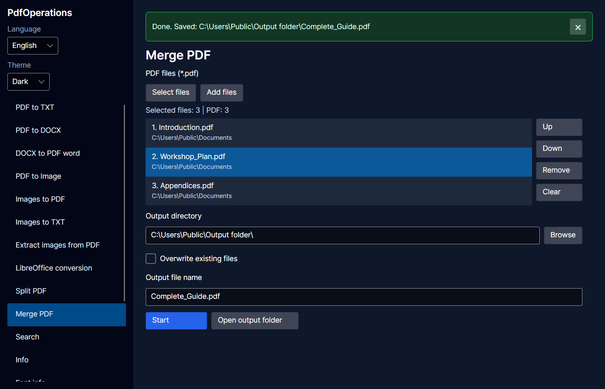
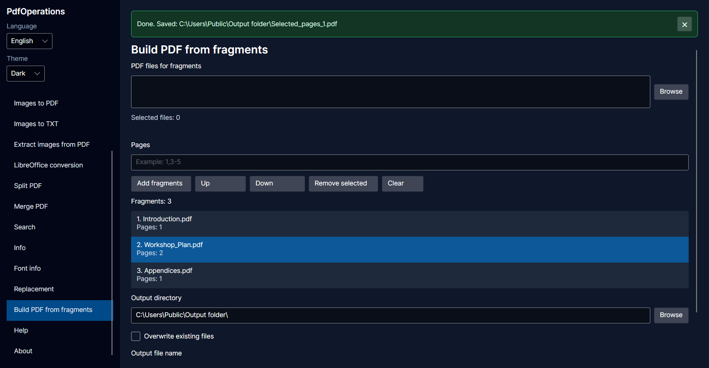
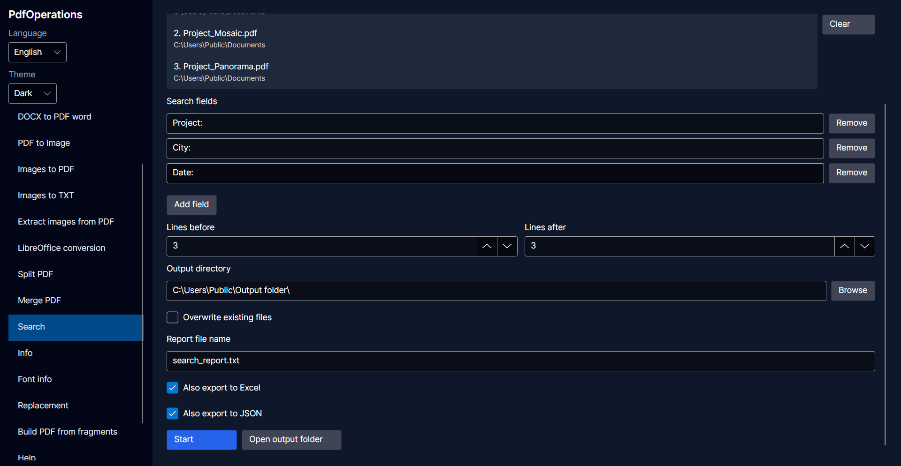

# PdfOperations

[English](README.md) | **Polski**

PdfOperations to aplikacja dla systemu Windows do pracy z plikami PDF, obrazami, tekstem i dokumentami biurowymi. Interfejs graficzny wykorzystuje bibliotekę Avalonia i jest dostępny po polsku i angielsku. Do wyboru są trzy motywy: jasny, ciemny i systemowy.

Repozytorium zawiera również pierwotną aplikację konsolową. Ten przewodnik opisuje obsługę wersji graficznej.

## Pobieranie i instalacja

Na [stronie wydań](https://github.com/DanBed666/PdfOperations/releases/latest) wybierz **jedną** z dwóch wersji dla Windows x64:

- **Instalator (`*-setup.exe`):** instaluje PdfOperations na Twoim koncie bez uprawnień administratora i zawiera .NET 10. Aby uruchomić program, wybierz **PdfOperations** w menu Start. Domyślny folder instalacji otworzysz, wklejając `%LOCALAPPDATA%\Programs\PdfOperations` w pasku adresu Eksploratora plików.
- **Wersja przenośna (`*-win-x64-portable.zip`):** zawiera środowisko .NET 10 Desktop Runtime, więc nie trzeba osobno instalować .NET. Rozpakuj **całe** archiwum ZIP do wybranego folderu i uruchom z niego `PdfOperations.Gui.exe`.

Osobne archiwum `third-party-sources.zip` zawiera kod źródłowy dołączonych narzędzi, a nie aplikację.

### Ręczna aktualizacja

PdfOperations nie sprawdza aktualizacji automatycznie. Aby zaktualizować program, zamknij go i pobierz nowszą wersję ze [strony wydań](https://github.com/DanBed666/PdfOperations/releases/latest).

- **Instalator:** uruchom nowy plik `*-setup.exe` z tego samego konta Windows i pozostaw dotychczasowy folder instalacji. Nie musisz odinstalowywać poprzedniej wersji.
- **Przenośny ZIP:** rozpakuj całe nowe archiwum z aplikacją do nowego folderu i uruchom z niego `PdfOperations.Gui.exe`. Jeśli korzystasz z własnego skrótu, zmień go tak, żeby wskazywał nowy plik wykonywalny.

## Funkcje

| Operacja | Opis |
| --- | --- |
| PDF do TXT | Odczytywanie zaznaczalnego tekstu z plików PDF. |
| PDF do DOCX | Konwersja plików PDF na dokumenty Word za pomocą narzędzia pdf2docx. |
| DOCX do PDF (Word) | Konwersja dokumentów DOCX do formatu PDF za pomocą zainstalowanego programu Microsoft Word. |
| PDF na obrazy | Zapisywanie stron PDF jako obrazów. |
| Obrazy na PDF | Łączenie obrazów w jeden PDF w wybranej kolejności. |
| Obrazy na TXT | Rozpoznawanie tekstu na obrazach za pomocą Tesseract OCR. |
| Wyodrębnianie obrazów | Wyodrębnianie obrazów osadzonych w plikach PDF. |
| Konwersja LibreOffice | Konwersja dokumentów biurowych do PDF, DOCX, ODT, XLSX, HTML lub TXT, w zakresie obsługiwanym przez LibreOffice. |
| Strony PDF | Wyodrębnianie wybranych, parzystych lub nieparzystych stron; podział po wskazanych stronach albo na pojedyncze strony. |
| Łączenie PDF | Łączenie plików PDF w kolejności widocznej na liście. |
| Utwórz PDF z fragmentów | Łączenie zakresów stron z jednego lub kilku plików PDF w wybranej kolejności. |
| Wyszukiwanie | Wyszukiwanie wielu fraz w plikach PDF, plikach TXT i na obrazach. Wyniki można zapisać w raporcie TXT, a odczytane wartości dodatkowo wyeksportować do Excela, do pliku JSON lub do obu formatów. |
| Informacje o PDF | Odczytywanie metadanych, liczby stron i informacji o czcionkach. |
| Zamiana tekstu | Zamiana tekstu w dokumentach DOCX, ODT i ODG na podstawie tabeli zamian w Excelu. |

Interfejs zawiera liczniki plików, filtry formatów, wskaźniki postępu, anulowanie operacji, opcję nadpisywania oraz rozwijane szczegóły błędów. Wybrany język i motyw są zapamiętywane między uruchomieniami programu.

## Wymagania i uruchomienie

- **PDF → DOCX:** instalator i wersja przenośna z dołączoną biblioteką Microsoft Visual C++ nie wymagają osobnej instalacji pakietu Visual C++. Warunki korzystania z biblioteki akceptujesz podczas instalacji, a w wersji przenośnej przed pierwszą konwersją PDF → DOCX.
- **Do opcji DOCX do PDF (Word):** potrzebny jest zainstalowany i aktywowany Microsoft Word. Bez Worda wybierz **Konwersja LibreOffice**; LibreOffice jest już w paczce.
- Narzędzia zewnętrzne wraz z plikami pomocniczymi muszą znajdować się w przewidzianym folderze `tools` obok aplikacji.
- Program potrzebuje uprawnień do zapisu w folderze wynikowym i folderach tymczasowych oraz wystarczającej ilości wolnego miejsca na dysku.

Szczegóły dotyczące obu wersji znajdziesz w [wymaganiach do uruchomienia](RUNTIME-REQUIREMENTS.pl.md).

Na początek wybierz operację z lewego paska. Wbudowana **Pomoc** jest dostępna w obu językach interfejsu.

## Podstawowa obsługa

1. Wybierz operację z bocznego paska.
2. Kliknij **Wybierz pliki**, aby wskazać pliki wejściowe. Nowy wybór zastąpi dotychczasową listę plików.
3. Użyj **Dodaj pliki**, aby dopisać kolejne pliki, również z innych folderów.
4. Wskaż folder zapisu i uzupełnij wymagane opcje, na przykład nazwę pliku, zakres stron lub szukane pola.
5. Kliknij **Start**, a następnie **Otwórz folder wynikowy**, aby sprawdzić rezultaty.

**Usuń** usuwa zaznaczone pozycje z listy, a **Wyczyść** opróżnia całą listę. Żaden z tych przycisków nie usuwa plików źródłowych z dysku. Możesz zaznaczyć i usunąć z listy kilka pozycji jednocześnie.

W operacjach, w których kolejność ma znaczenie, ustaw ją przyciskami **W górę** i **W dół** przed uruchomieniem. Łączenie PDF zachowuje kolejność widoczną na liście, bez ponownego sortowania alfabetycznego podczas konwersji.

Tam, gdzie jest to obsługiwane, puste pole folderu zapisu jest uzupełniane na podstawie pierwszego pliku wejściowego. Wcześniej wybrany folder nie jest automatycznie zmieniany. Sprawdź go przed rozpoczęciem, szczególnie jeśli pliki pochodzą z różnych lokalizacji.

Gdy opcja **Nadpisz istniejące pliki** jest wyłączona, przy konflikcie nazw program dodaje do nazwy wynikowej kolejne numery. Włączenie tej opcji pozwala zastępować istniejące pliki docelowe. Różne pliki wejściowe o tej samej nazwie bazowej nadal otrzymują odrębne nazwy wynikowe w ramach jednej partii. Przy nadpisywaniu zachowaj kopie zapasowe.

Przycisk **Anuluj** zgłasza żądanie zatrzymania operacji. Anulowanie nie cofa wykonanych działań: wcześniej zapisane pliki mogą pozostać w folderze wynikowym. Program próbuje usunąć pliki tymczasowe po zakończeniu, błędzie i anulowaniu; blokada pliku przez inny proces może jednak uniemożliwić sprzątanie.

## Strony i fragmenty PDF

Numeracja stron zaczyna się od 1. Możesz wskazywać pojedyncze strony i zakresy, na przykład `1`, `2-5` lub `1,3-5,8`.

- **Wybrane strony**: program tworzy plik PDF zawierający tylko wskazane strony.
- **Strony parzyste** i **Strony nieparzyste**: program wybiera strony automatycznie.
- **Podziel po podanych stronach**: każda wpisana liczba wskazuje stronę, po której program dzieli plik. Na przykład wpisanie `2,5` dla siedmiostronicowego dokumentu daje trzy części: strony 1–2, 3–5 i 6–7.
- **Podziel każdą stronę osobno**: program zapisuje każdą stronę jako osobny plik PDF.

Opcja **Utwórz PDF z fragmentów** pozwala złożyć dokument z zakresów stron z jednego lub kilku plików PDF. Sprawdź wybrane strony i ułóż fragmenty w takiej kolejności, w jakiej mają się pojawić w gotowym dokumencie.

## Wyszukiwanie i odczytywanie wartości

Wyszukiwanie obsługuje pliki PDF, TXT i obrazy. Korzystaj z filtra typu pliku w oknie wyboru, aby przypadkowo nie zaznaczyć razem dokumentów PDF i wcześniej wygenerowanych raportów TXT.

Wpisz frazę w sekcji **Szukane pola**, a kolejne dodawaj przyciskiem **Dodaj pole**. Puste pola są pomijane. Wymagana jest co najmniej jedna fraza, a nazwy pól nie mogą się powtarzać, także przy różnej wielkości liter.

Raport TXT zawiera wystąpienia wszystkich fraz, również wewnątrz dłuższego tekstu. Wyszukiwanie nie rozróżnia wielkich i małych liter. Ustawienia liczby linii przed i po wyniku określają, ile otaczającego tekstu zostanie uwzględnione w raporcie. `[0]` oznacza linię z wynikiem, `[-1]` poprzednią, a `[+1]` następną.

### Eksport do Excela i JSON

Zaznacz **Zapisz również do Excela**, **Zapisz również do JSON** lub obie opcje. Raport TXT także zostanie zapisany.

Aby odczytywać wartości, podawaj etykiety występujące w dokumentach. Są to dowolne frazy wpisane przez użytkownika, a nie wbudowana lista numerów telefonów, identyfikatorów podatkowych czy adresów. Przykładowy dokument:

```text
Numer sprawy: 00123
Firma:
Przykładowe Studio
```

Wyszukiwanie pól `Numer sprawy` i `Firma` pozwala odczytać wartości `00123` i `Przykładowe Studio`. Dla każdej frazy możesz wybrać zapis całej znalezionej linii albo tylko wartości po frazie. Wyszukiwanie nie rozróżnia wielkich i małych liter i znajduje również frazę wewnątrz dłuższego tekstu.

**Opcja „Eksportuj każde trafienie jako osobny wpis” niezaznaczona (podsumowanie):**

- Każdy plik wejściowy otrzymuje jeden wiersz w Excelu lub jeden obiekt w JSON. Pełne ścieżki rozróżniają pliki o tej samej nazwie z różnych folderów.
- Każde szukane pole otrzymuje kolumnę w Excelu lub wpis w obiekcie pól w JSON.
- Identyczne wartości w obrębie jednego pliku i pola są zapisywane tylko raz. Różne wartości trafiają do osobnych linii w jednej komórce Excela lub do elementów tablicy w JSON.
- Brak wartości oznacza pustą komórkę w Excelu lub pustą tablicę w JSON.

**Opcja „Eksportuj każde trafienie jako osobny wpis” zaznaczona:**

- Każda pasująca linia dla danej frazy otrzymuje osobny wiersz w Excelu lub obiekt w JSON: nazwę pliku, pełną ścieżkę, stronę, linię, frazę i wartość.
- Powtarzające się wartości zostają zachowane. Trafienie bez odczytanej wartości jest zapisywane z pustą wartością; pliki bez trafień nie tworzą wpisów.
- Kilka wystąpień tej samej frazy w jednej linii daje jeden wpis dla tej linii, a nie osobny wpis dla każdego wystąpienia.

Przykładowo dwa różne numery telefonu znalezione w jednym PDF zajmą w podsumowaniu dwie linie w jednej komórce Excela lub dwa elementy tablicy w JSON. Po włączeniu osobnych wpisów zajmą dwa wiersze lub obiekty, jeśli znaleziono je w różnych liniach. Podsumowanie zachowuje wszystkie różne wartości, a nie tylko ostatni wynik.

**W obu trybach:**

- Wartości są zapisywane jako tekst, dzięki czemu zachowują zera na początku.
- Język interfejsu w chwili rozpoczęcia operacji określa język stałych nagłówków Excela, nazwę arkusza i klucze JSON. Szukane frazy i odczytane wartości nie są tłumaczone.
- Tryb eksportu nie zmienia raportu TXT. Żaden z trybów nie łączy automatycznie nazwisk, telefonów ani innych pól należących do tej samej osoby.

| Element eksportu | Angielski | Polski |
| --- | --- | --- |
| Arkusz Excel | `Results` | `Wyniki` |
| Nazwa pliku w Excelu | `File name` | `Nazwa pliku` |
| Ścieżka pliku w Excelu | `File path` | `Ścieżka pliku` |
| Nazwa pliku w JSON | `FileName` | `NazwaPliku` |
| Ścieżka pliku w JSON | `FilePath` | `SciezkaPliku` |
| Pola w JSON | `Fields` | `Pola` |
| Strona w osobnych wpisach | `Page` | `Strona` |
| Linia w osobnych wpisach | `Line` | `Linia` |
| Fraza w osobnych wpisach | `Phrase` | `Fraza` |
| Wartość w Excelu w osobnych wpisach | `Value` | `Wartość` |
| Wartość w JSON w osobnych wpisach | `DesiredValue` | `Wartosc` |

Jeśli inny program odczytuje wyeksportowany JSON, uwzględnij klucze zależne od wybranego języka.

### Ograniczenia odczytu

Przy zapisie samej wartości program odczytuje tekst po frazie i opcjonalnym dwukropku. Jeżeli jest pusty, sprawdza następną niepustą linię tej samej strony. Nie zależy to od ustawień liczby linii przed i po wyniku w raporcie TXT. Opcja zapisu całej linii zapisuje zamiast tego linię z dopasowaniem.

Jeśli następna linia zawiera inną szukaną etykietę, wartość pozostaje pusta. Program może jednak potraktować nierozpoznaną etykietę jako wartość. Przykład: szukasz tylko pola `Numer sprawy`. Jeśli po pustym polu `Numer sprawy:` jest linia `Adres: ul. Główna`, program może odczytać `Adres: ul. Główna` jako numer sprawy. Sprawdź wyeksportowane dane przed ich wykorzystaniem.

Przy zapisie samej wartości program próbuje zakończyć odczyt przed kolejną etykietą, również niewybraną, jeśli występuje po przecinku i kończy się dwukropkiem. To rozpoznawanie na podstawie wzorca, a nie znajomość struktury dokumentu: niejednoznaczny tekst może wymagać ręcznej korekty. Zapis całej linii nie stosuje tego przycinania.

Wyszukiwanie w PDF odczytuje warstwę tekstową; nie wykonuje automatycznie OCR zeskanowanych stron PDF. W przypadku skanów bez zaznaczalnego tekstu najpierw zapisz strony jako obrazy, a następnie użyj OCR lub wyszukiwania w obrazach. Dokładność OCR zależy od jakości obrazów i dostępnych danych językowych.

## Zamiana tekstu

W widoku **Zamiana tekstu** kliknij **Pobierz szablon Excel** pod wyborem arkusza. Wybierz folder, w którym zapiszesz `replacement-template.xlsx`. Program tworzy plik lokalnie, bez połączenia z internetem. Zapisanie szablonu nie uruchamia zamiany ani nie wybiera go automatycznie do operacji.

Otwórz plik w Excelu lub LibreOffice Calc, zastąp przykładowe zamiany własnymi i dodaj kolejne wiersze, jeśli są potrzebne. Zapisz jako `.xlsx`, a następnie wskaż go przyciskiem **Przeglądaj** obok pola **Arkusz Excel z zamianami**. Szablon nie jest zabezpieczony przed edycją i jest wspólny dla obu języków interfejsu:

| Lp | Find | Replace | IgnoreCase |
| --- | --- | --- | --- |
| 1 | `{{COMPANY}}` | Example Studio | TRUE |
| 2 | `{{CITY}}` | Warsaw | FALSE |

Zachowaj pierwszy wiersz z nagłówkami i kolejność kolumn. `TRUE` ignoruje wielkość liter, a `FALSE` ją uwzględnia. Nie tłumacz tych dwóch wartości. Nawiasy w przykładach są opcjonalne: Find może zawierać zwykły tekst. Kolumny Find i Replace mają format tekstowy, aby zachowywać zera na początku.

Zamiana tekstu obsługuje dokumenty DOCX, ODT i ODG, a nie pliki PDF ani zeskanowane obrazy. Korzysta z **pierwszego arkusza pliku Excel**. Pierwszy wiersz jest traktowany jako nagłówek, a kolejne wiersze są odczytywane według położenia kolumn:

| Kolumna | Przeznaczenie | Przykład |
| --- | --- | --- |
| A | Numer (`Lp`) | `1` |
| B | Tekst do znalezienia (`Find`) | `{{FIRMA}}` |
| C | Tekst do wstawienia (`Replace`) | `Przykładowe Studio` |
| D | Ignorowanie wielkości liter (`IgnoreCase`) | `TRUE` lub `FALSE` |

Program pomija wiersze z pustą komórką `Find`. Pusta komórka `Replace` oznacza usunięcie znalezionego tekstu. Reguły są stosowane w kolejności wierszy, więc późniejsza reguła może zmienić wynik wcześniejszej. Zamiana miejscami wartości `Find` i `Replace` odwraca kierunek reguły, ale nie cofa wcześniejszych zmian. Aby odzyskać oryginalny tekst, skorzystaj z kopii zapasowej.

Pracuj na kopiach ważnych dokumentów i sprawdzaj wyniki. W głównej treści dokumentu DOCX program rozpoznaje frazę nawet wtedy, gdy jej fragmenty mają różne formatowanie w obrębie jednego akapitu. Wstawiony tekst przejmuje formatowanie początku frazy, a tekst wokół niej zachowuje swoje formatowanie. Program nie łączy tekstu rozdzielonego granicą akapitu, tabulatorem ani podziałem wiersza. Nie przetwarza nagłówków ani stopek stron.

ODT i ODG również obsługują frazy podzielone przez formatowanie w obrębie akapitu lub nagłówka, także w polach tekstowych. Wstawiony tekst przejmuje formatowanie początku trafienia. Style, adresy linków i pozostałe atrybuty XML nie są przeszukiwane ani zmieniane. Dopasowanie nie przechodzi przez granice akapitów, tabulatory, podziały wiersza, pola automatyczne ani osadzone obiekty.

## Narzędzia zewnętrzne i uwagi o wynikach

| Narzędzie | Zastosowanie |
| --- | --- |
| LibreOffice | Konwersja dokumentów biurowych. |
| Poppler | Odczyt tekstu z PDF, renderowanie stron, wyodrębnianie obrazów, łączenie i odczyt informacji. |
| qpdf | Operacje na stronach PDF. |
| Tesseract OCR | Rozpoznawanie tekstu na obrazach. |
| ImageMagick | Konwersja obrazów do PDF. |
| Program pdf2docx | Konwersja PDF do DOCX. |

Lokalizacje plików wykonywalnych są określone w [ToolPaths.cs](PdfOperations/Infrastructure/ToolPaths.cs). Zachowaj przewidziane nazwy podfolderów oraz biblioteki i dane pomocnicze narzędzi, nie tylko same pliki wykonywalne. Zainstalowanie narzędzia w innym miejscu lub dodanie go do PATH nie zmienia tych skonfigurowanych lokalizacji.

- Formaty wejściowe konwersji LibreOffice to DOCX, ODT, DOC, ODG, RTF, XLSX, ODS, PPTX i ODP. LibreOffice nie obsługuje każdej kombinacji formatu wejściowego i wyjściowego.
- Wyniki konwersji LibreOffice do HTML są zapisywane w osobnym folderze wraz z obrazami i innymi wygenerowanymi plikami pomocniczymi. Przechowuj je razem.
- Obrazy wyodrębnione z PDF mogą mieć różne formaty, na przykład PNG lub JPEG. Wyodrębnianie obrazów nie jest tym samym co zapisywanie każdej strony jako JPEG.
- Konwersje dokumentów biurowych mogą zależeć od zainstalowanych czcionek i układu dokumentu. Sprawdź pliki wynikowe.
- Jeśli tekst w pliku PDF utworzonym przez LibreOffice wygląda inaczej niż w Wordzie, LibreOffice mógł użyć zamiennika brakującej czcionki. Pobierz czcionkę ze strony jej wydawcy i zainstaluj w systemie Windows te jej odmiany, których użyto w dokumencie (np. zwykłą, pogrubioną i pochyłą). Następnie ponów konwersję.
- Dokumenty zabezpieczone hasłem lub uszkodzone mogą powodować błąd. Rozwiń szczegóły błędu, aby zobaczyć komunikat używanego narzędzia.
- Limity czasu dotyczą pojedynczych wywołań narzędzi lub etapów przetwarzania, a nie jednego wspólnego limitu dla całej partii. Wartości domyślne są określone w [OperationTimeouts.cs](PdfOperations/Infrastructure/OperationTimeouts.cs).
- Konwersja LibreOffice monitoruje rozmiar danych tymczasowych i wolne miejsce. Obecne wartości domyślne to limit 2 GiB danych tymczasowych oraz wymagane minimum 2 GiB wolnego miejsca na monitorowanych dyskach. Szczegóły znajdują się w [LibreOfficeDiskGuard.cs](PdfOperations/Infrastructure/LibreOfficeDiskGuard.cs).

Ustawienia języka i motywu są zapisywane w `%APPDATA%\PdfOperations\settings.json`. Nie oznacza to zapisywania bieżących list plików ani niedokończonych operacji między uruchomieniami aplikacji.

## Kompilacja i testy

Praca nad kodem wymaga systemu Windows i .NET 10 SDK. W głównym katalogu repozytorium wykonaj:

```powershell
dotnet build PdfOperations.Gui/PdfOperations.Gui/PdfOperations.Gui.csproj -c Release
dotnet run --project PdfOperations.Gui/PdfOperations.Gui/PdfOperations.Gui.csproj -c Release
```

Narzędzia zewnętrzne są ignorowane przez Git i trzeba je dostarczyć osobno. Podczas kompilacji GUI w konfiguracji Release narzędzia są kopiowane z `PdfOperations/bin/Release/net10.0-windows/tools` do folderu wynikowego GUI. Upewnij się, że gotowa paczka także zawiera kompletny folder `tools` obok pliku wykonywalnego GUI. Sama udana kompilacja .NET nie potwierdza obecności tych zależności.

Uruchomienie testów automatycznych:

```powershell
dotnet test PdfOperations.Tests/PdfOperations.Tests/PdfOperations.Tests.csproj -c Release
```

Część testów to testy integracyjne wymagające odpowiednich narzędzi zewnętrznych. Testy konwersji za pomocą programu Word wymagają jego zainstalowania. Podczas kompilacji folder `TestData` jest kopiowany do folderu wynikowego projektu testowego.

Aby zamiast GUI uruchomić pierwotną aplikację konsolową:

```powershell
dotnet run --project PdfOperations/PdfOperations.csproj -c Release
```

## Autor i wykorzystane narzędzia

Autor: [DanBed666](https://github.com/DanBed666). Repozytorium projektu: [PdfOperations](https://github.com/DanBed666/PdfOperations).

Widok **O programie** w aplikacji zawiera jej wersję, autora i linki do poniższych projektów.

### Biblioteki i czcionka

- [Avalonia](https://github.com/AvaloniaUI/Avalonia) - interfejs graficzny aplikacji.
- [CommunityToolkit.Mvvm](https://github.com/CommunityToolkit/dotnet) - modele widoków, polecenia i powiadomienia o zmianach właściwości.
- [ClosedXML](https://github.com/ClosedXML/ClosedXML) - odczyt i zapis plików Excel.
- [Inter](https://rsms.me/inter/) - czcionka interfejsu.

### Narzędzia zewnętrzne

- [LibreOffice](https://www.libreoffice.org/) - konwersja dokumentów biurowych.
- [Poppler](https://poppler.freedesktop.org/) - odczyt tekstu i obrazów z PDF, łączenie plików oraz odczyt informacji.
- [qpdf](https://qpdf.sourceforge.io/) - operacje na stronach PDF.
- [Tesseract OCR](https://github.com/tesseract-ocr/tesseract) - rozpoznawanie tekstu na obrazach.
- [ImageMagick](https://imagemagick.org/) - konwersja obrazów do PDF.
- [pdf2docx](https://github.com/ArtifexSoftware/pdf2docx) - konwersja PDF do DOCX.

### Wsparcie AI podczas tworzenia

Aplikacja powstała przy częściowym wsparciu [OpenAI Codex](https://openai.com/codex/).

## Zrzuty ekranu

### Łączenie PDF


### PDF z fragmentów


### Wyszukiwanie i eksport

